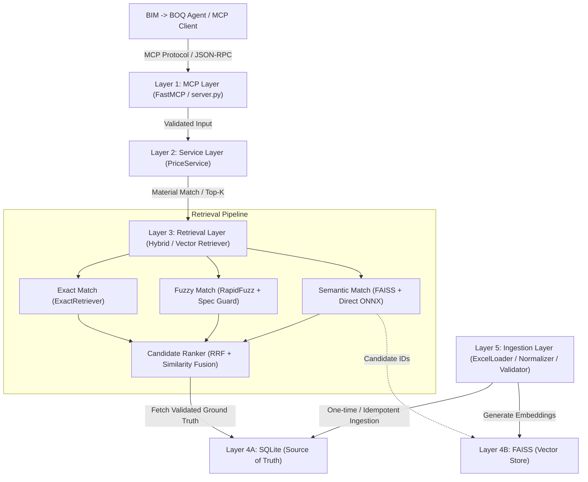

# Construction Price RAG MCP Server

ระบบสืบค้นราคาวัสดุก่อสร้างและอัตราค่าแรงงาน (Construction Material & Labor Price Retrieval) สำหรับการประมาณราคาและถอดแบบ BOQ อัตโนมัติจากโมเดล BIM ผ่านโปรโตคอล **Model Context Protocol (MCP)** พัฒนาด้วย **Python** และ **FastMCP** พร้อมกลไก **Hybrid Retrieval (Exact + Fuzzy + Semantic)** ที่แม่นยำสูง

---

## 1. Project Overview

ระบบนี้เป็นส่วนประกอบสำคัญของสถาปัตยกรรม **Agentic AI for Construction Cost Estimation & BOQ Generation**:

$$\text{BIM Model} \longrightarrow \text{Element Classification} \longrightarrow \text{Quantity Takeoff} \longrightarrow \mathbf{\text{Price Retrieval (ระบบนี้)}} \longrightarrow \text{Cost Calculation} \longrightarrow \text{BOQ Output}$$

### หน้าที่และความรับผิดชอบหลัก
- **ทำหน้าที่เฉพาะด้าน Price Retrieval**: ค้นหาราคาวัสดุและค่าแรงจากฐานข้อมูลอ้างอิงจริง
- **ไม่ทำหน้าที่คำนวณปริมาณหรือวิเคราะห์ BIM**: แยกความรับผิดชอบชัดเจนตามหลัก Separation of Concerns
- **รักษาความถูกต้องของข้อมูลราคา 100%**: SQLite ทำหน้าที่เป็น **Single Source of Truth** ราคาจริงต้องมาจากฐานข้อมูลเท่านั้น ห้ามเดาหรือสร้างตัวเลขขึ้นเอง
- **เปิดฟังก์ชันการทำงานผ่าน MCP Protocol**: เชื่อมต่อกับ BIM Agent, Claude Desktop, Antigravity หรือ MCP Client ภายนอกได้อย่างไร้รอยต่อ

---

## 2. System Architecture

สถาปัตยกรรมระบบออกแบบแยกออกเป็น 5 Layers อิสระตามหลัก **Separation of Concerns**:



### หน้าที่ของแต่ละ Layer
1. **Layer 1: MCP Layer (`app/tools/`, `server.py`)**:
   - ประกาศ MCP Server ผ่าน `FastMCP`
   - ลงทะเบียนเฉพาะ MCP Tool `match_material` ตามคำสั่ง สำหรับ BIM Element to Price Matching
   - ไม่เขียน Retrieval Logic ใน Tool โดยตรง ให้ส่งต่อคำขอไปยัง Service Layer
2. **Layer 2: Service Layer (`app/services/price_service.py`)**:
   - ควบคุม Business Logic การตรวจสอบอินพุต (`material`), การสืบค้นผ่าน FAISS Vector DB และการดึงราคาจาก SQLite
   - แปลงผลลัพธ์เป็น JSON-safe serialization
3. **Layer 3: Retrieval Layer (`app/retrieval/`)**:
   - แยกกลไกการสืบค้นเป็น `ExactRetriever`, `FuzzyRetriever`, `SemanticRetriever`
   - รวมคะแนนและจัดอันดับด้วย `CandidateRanker` (ใช้ Reciprocal Rank Fusion: RRF)
   - ป้องกันการจับคู่สเปกผิดพลาด (เช่น DB12 จะต้องไม่ไปจับคู่กับ DB16 หรือ DB20)
4. **Layer 4: Data Layer (`app/database/`, `app/embeddings/`)**:
   - **SQLite (`app/database/sqlite_db.py`)**: แหล่งเก็บข้อมูลราคาจริง (Source of Truth) เก็บประวัติ วันที่ แหล่งอ้างอิง และข้อมูลแถวเดิมของ Excel แบบ 100% Traceable
   - **FAISS (`app/database/vector_db.py`)**: เวกเตอร์อินเด็กซ์ `faiss.IndexFlatIP` ประสิทธิภาพสูง ทำงานในหน่วยความจำและเซฟลงไฟล์ `data/faiss_index/` เร็วกว่า ChromaDB หลายสิบเท่าโดยไม่มี overhead
5. **Layer 5: Ingestion Layer (`app/ingestion/`)**:
   - อ่านไฟล์ Excel เฉพาะ Worksheet **"วัสดุพื้นฐาน"**
   - Normalize ชื่อ, หน่วย, ช่วงราคา และแปลงปี พ.ศ. 2569 เป็น ค.ศ. 2026
   - รองรับการทำงานแบบ Idempotent (นำเข้าซ้ำแล้วไม่งอก Record ซ้ำ)

---

## 3. Technology Stack

| Component | Technology | Version | หน้าที่รับผิดชอบ |
|---|---|---|---|
| Programming Language | Python | 3.14+ | ภาษาหลักในการพัฒนา |
| MCP Framework | FastMCP | 3.1.0 | จัดการ MCP Server, Tools และ JSON-RPC Transport |
| Data Processing | Pandas & OpenPyXL | 3.0+ / 3.1+ | ตรวจสอบและอ่านข้อมูลจากไฟล์ Excel |
| Structured Database | SQLite | 3.x | **Source of Truth** เก็บข้อมูลราคาจริงและ Metadata |
| Vector Database | FAISS | 1.13.2 | จัดเก็บ Embedding Index เพื่อการค้นหาเชิงความหมาย (เร็วพิเศษ) |
| Embeddings Inference | ONNX Runtime | 1.20+ | โหลดโมเดล `all-MiniLM-L6-v2` แบบ Standalone ออฟไลน์ |
| Approximate Matching | RapidFuzz | 3.14+ | ค้นหาข้อความใกล้เคียงและการพิมพ์ผิด (Fuzzy Search) |
| Thai NLP Tokenizer | PyThaiNLP | 5.4.0 | ตัดคำภาษาไทยเพื่อเสริมประสิทธิภาพการจับคู่คำค้นหา |
| Schema & Validation | Pydantic | 2.12+ | ตรวจสอบโครงสร้างข้อมูลและสร้าง Type Safety |
| Testing Framework | Pytest | 9.0+ | ชุดทดสอบ Unit Tests และ Integration Tests |

---

## 4. Folder Structure

```text
price_rag/
│
├── server.py                        # Entry Point สำหรับรัน FastMCP Server
├── evaluate_retrieval.py            # สคริปต์ประเมินคุณภาพการสืบค้น (Benchmark Evaluation)
├── requirements.txt                 # รายการ Dependencies
├── .env.example                     # ไฟล์ตัวอย่างการตั้งค่า Environment Variables
├── .gitignore                       # ละเว้นไฟล์ที่ไม่ต้องการ commit ขึ้น git
├── README.md                        # เอกสารคู่มือระบบฉบับสมบูรณ์
│
├── app/
│   ├── __init__.py
│   ├── config.py                    # จัดการ Configuration และตั้งค่า Logging ออก stderr
│   │
│   ├── schemas/                     # Pydantic Schemas
│   │   ├── __init__.py
│   │   └── price_record.py          # PriceRecord, SearchResponse, DatabaseInfo
│   │
│   ├── ingestion/                   # Data Ingestion Pipeline
│   │   ├── __init__.py
│   │   ├── excel_loader.py          # อ่านไฟล์ Excel เฉพาะ Worksheet "วัสดุพื้นฐาน"
│   │   ├── data_normalizer.py       # ทำความสะอาดข้อมูล แปลงหน่วย วันที่ และราคา
│   │   ├── data_validator.py        # ตรวจสอบความถูกต้องของข้อมูลตามกฎ
│   │   └── ingestion_service.py     # ตัวขับเคลื่อน Pipeline และบันทึกลง SQLite/ChromaDB
│   │
│   ├── database/                    # Data Storage Layer
│   │   ├── __init__.py
│   │   ├── sqlite_db.py             # SQLite Source of Truth Database
│   │   └── vector_db.py             # ChromaDB Persistent Vector Storage
│   │
│   ├── embeddings/                  # Embeddings Provider Layer
│   │   ├── __init__.py
│   │   └── embedding_provider.py    # Chroma Default ONNX และ Fallback Providers
│   │
│   ├── retrieval/                   # Search & Ranking Engines
│   │   ├── __init__.py
│   │   ├── exact_retriever.py       # ค้นหาแบบตรงตัวและตัดคำสร้อยคำถาม
│   │   ├── fuzzy_retriever.py       # ค้นหาคำใกล้เคียง พร้อมระบบ Spec Conflict Guard
│   │   ├── semantic_retriever.py    # ค้นหาความหมายด้วย ChromaDB
│   │   ├── ranking.py               # Reciprocal Rank Fusion (RRF) & Fusion Scorer
│   │   └── hybrid_retriever.py      # ตัวประสาน Hybrid Pipeline
│   │
│   ├── services/                    # Business Service Layer
│   │   ├── __init__.py
│   │   └── price_service.py         # Business Logic สำหรับ MCP Tools
│   │
│   └── tools/                       # MCP Tools Registration
│       ├── __init__.py
│       └── price_tools.py           # ลงทะเบียน Tools 3 รายการกับ FastMCP
│
├── data/
│   ├── Real_Price_Database.xlsx     # ไฟล์ Excel ข้อมูลราคาต้นฉบับ
│   ├── price.db                     # SQLite Database (สร้างอัตโนมัติ)
│   └── chroma_db/                   # ChromaDB Directory (สร้างอัตโนมัติ)
│
└── tests/                           # ชุดทดสอบอัตโนมัติ (Automated Tests)
    ├── __init__.py
    ├── test_ingestion.py            # ทดสอบการโหลด Excel และ Idempotency
    ├── test_normalizer.py           # ทดสอบการ Normalize ราคา หน่วย วันที่
    ├── test_exact_retrieval.py      # ทดสอบ Exact Search
    ├── test_fuzzy_retrieval.py      # ทดสอบ Fuzzy Search และ Spec Guard
    ├── test_semantic_retrieval.py   # ทดสอบ Semantic Search
    ├── test_hybrid_retrieval.py     # ทดสอบ Hybrid Pipeline และการกรองข้อมูล
    └── test_mcp_tools.py            # ทดสอบ MCP Tools ทั้ง 3 ฟังก์ชัน
```

---

## 5. Installation

### ข้อกำหนดเบื้องต้น
- Python 3.10 ขึ้นไป (แนะนำ Python 3.11 - 3.14)
- Git

### ขั้นตอนการติดตั้ง
1. Clone หรือเปิดโฟลเดอร์โปรเจกต์:
   ```bash
   cd price_rag
   ```

2. สร้างและเปิดใช้งาน Virtual Environment (แนะนำ):
   ```powershell
   # Windows PowerShell
   python -m venv .venv
   .\.venv\Scripts\Activate.ps1
   ```
   ```bash
   # Linux / macOS
   python3 -m venv .venv
   source .venv/bin/activate
   ```

3. ติดตั้ง Packages ที่จำเป็น:
   ```bash
   pip install -r requirements.txt
   ```

---

## 6. Environment Configuration

คัดลอกไฟล์ตัวอย่าง `.env.example` ไปเป็น `.env`:

```bash
# Windows PowerShell
Copy-Item .env.example .env

# Linux / macOS
cp .env.example .env
```

เนื้อหาการตั้งค่าใน `.env`:
```env
# ที่ตั้งไฟล์ข้อมูลต้นทาง
EXCEL_FILE_PATH=data/Real_Price_Database.xlsx
EXCEL_WORKSHEET=วัสดุพื้นฐาน

# ฐานข้อมูล
SQLITE_DB_PATH=data/price.db
CHROMA_PERSIST_DIRECTORY=data/chroma_db
CHROMA_COLLECTION_NAME=construction_prices

# การค้นหาเชิงความหมาย (Semantic Search)
ENABLE_SEMANTIC_SEARCH=true
EMBEDDING_PROVIDER=chroma_default
EMBEDDING_MODEL=all-MiniLM-L6-v2

# ค่า Threshold และ Ranking
DEFAULT_SIMILARITY_THRESHOLD=0.35
RRF_K=60

# FastMCP Server
MCP_TRANSPORT=stdio
LOG_LEVEL=INFO
```

---

## 7. Data Ingestion

ข้อมูลต้นทางมาจากไฟล์ `Real_Price_Database.xlsx` โดยระบบถูกล็อกให้อ่านเฉพาะ Worksheet **"วัสดุพื้นฐาน"** ตามข้อกำหนดอย่างเคร่งครัด

### สรุปข้อมูลที่นำเข้าจาก Excel
- **แถวที่ 5 - 24**: รายการวัสดุก่อสร้างพื้นฐาน **20 รายการ** (รหัส `MAT-001` ถึง `MAT-020`) เช่น ปูนซีเมนต์, ทราย, หิน, เหล็กเส้นข้ออ้อย SD40, เหล็กเส้นกลม SR24, คอนกรีตผสมเสร็จ, อิฐมอญ, อิฐบล็อก, ไม้แบบ, กระเบื้อง
- **แถวที่ 28 - 32**: รายการอัตราค่าแรงงาน **5 รายการ** (รหัส `LAB-001` ถึง `LAB-005`) เช่น ค่าแรงก่ออิฐ, ค่าแรงฉาบปูน, ค่าแรงเทพื้น, ค่าแรงปูกระเบื้อง, ค่าแรงผูกเหล็กและเทคอนกรีต
- **รวมทั้งสิ้น 25 รายการ** ข้อมูลแถวว่าง หัวตาราง และหมายเหตุท้ายตารางถูกคัดกรองออกอย่างถูกต้อง

### สั่งรัน Ingestion ด้วยตนเอง
```bash
python -c "from app.ingestion.ingestion_service import IngestionService; report = IngestionService().run_ingestion(); print(report.model_dump_json(indent=2))"
```

### คุณสมบัติ Idempotency
หากรัน Ingestion ซ้ำ ระบบจะทำ `ON CONFLICT(price_id) DO UPDATE` โดยตรวจสอบจากรหัสคงที่ จะไม่งอกรายการซ้ำใน SQLite และ ChromaDB

---

## 8. Database Design

### SQLite Database (`data/price.db`) - Source of Truth
โครงสร้างตาราง `prices`:
- `price_id` (TEXT PRIMARY KEY): รหัสอ้างอิง เช่น `MAT-001`, `LAB-001`
- `record_type` (TEXT NOT NULL): `material` หรือ `labor`
- `item_name` (TEXT NOT NULL): ชื่อรายการตามไฟล์ต้นทาง
- `normalized_item_name` (TEXT NOT NULL): ชื่อรายการที่ตัดช่องว่างและจัดรูปแบบ
- `category` (TEXT): กลุ่มหมวดหมู่ (กำหนดเป็น `NULL` หากไม่มีในไฟล์ต้นทาง)
- `unit` (TEXT NOT NULL): หน่วยนับต้นฉบับ เช่น `กก.`, `ลบ.ม. (คิว)`, `ตร.ม. (ที่ใช้)`
- `normalized_unit` (TEXT NOT NULL): หน่วยนับมาตรฐาน เช่น `กก.`, `ลบ.ม.`, `ตร.ม.`
- `unit_price` (TEXT NOT NULL): ราคาต่อหน่วย เก็บเป็นข้อความ Decimal เพื่อป้องกัน Floating Point Error
- `market_min` / `market_max` (TEXT): ช่วงราคาต่ำสุด-สูงสุดในตลาด
- `currency` (TEXT NOT NULL): สกุลเงิน (`THB`)
- `price_date` (TEXT): วันที่อ้างอิงราคา รูปแบบ ISO (`2026-07-01`)
- `source_name` / `source_url` / `source_note`: แหล่งอ้างอิงและหมายเหตุจริง
- `vat_included` (INTEGER): `0` (ไม่รวม VAT ตามหัวตาราง Excel)
- `transportation_included` (INTEGER): `0` (ไม่รวมค่าขนส่ง)
- `original_excel_row` (INTEGER NOT NULL): ลำดับแถวใน Excel เพื่อการตรวจสอบย้อนกลับ (Traceability)
- `raw_source_data` (TEXT): ข้อมูลดิบทุกคอลัมน์ในรูปแบบ JSON
- `imported_at` (TEXT NOT NULL): เวลาที่นำเข้าข้อมูล

### ChromaDB Vector Store (`data/chroma_db/`)
- ใช้จัดเก็บ Embedding ของเอกสารข้อความ:
  `"{item_name} | หน่วย: {unit} | หมายเหตุ: {source_note}"`
- **ข้อกำหนดสำคัญ**: ChromaDB ใช้เฉพาะการระบุ `price_id` ของ Candidate เท่านั้น จากนั้นระบบจะนำ `price_id` ไปอ่านข้อมูลราคาจริงจาก SQLite เสมอ

---

## 9. Retrieval Workflow

ระบบสืบค้นราคาทำงานตามกระบวนการแบบเป็นขั้นตอน (Pipeline) ดังนี้:

```text
คำถามจากผู้ใช้ (User Query)
        │
        ▼
1. Query Normalization & Spec Extraction
   - ตัดคำสร้อยคำถาม ("ราคาเท่าไร", "ขอราคา", "กี่บาท")
   - สกัด Technical Specs: DB12, DB16, DB20, RB6, RB9, SD40, 280 ksc
   - แปลง Unit Alias (เช่น "kg" -> "กก.", "คิว" -> "ลบ.ม.")
        │
        ▼
2. Exact Search (ExactRetriever)
   - ตรวจสอบคำค้นหากับชื่อวัสดุ หรือ Core Specification Prefix
   - หากพบ Exact Match จะได้รับคะแนนสูงสุด (Score = 1.0)
        │
        ▼
3. Fuzzy Search (FuzzyRetriever)
   - ใช้ RapidFuzz (WRatio + Token Set Ratio) รองรับการพิมพ์ผิด
   - ตรวจสอบ Domain Usage Keywords (เช่น "ปลอกเสา", "คอนกรีต")
   - Guardrail สำคัญ: หากค้นหา DB12 รายการ DB16 หรือ DB20 จะถูกลงโทษคะแนนตัดทิ้งทันที
        │
        ▼
4. Semantic Search (SemanticRetriever)
   - ดึง Candidate ตามความหมายจาก ChromaDB
   - Hydrate ข้อมูลฉบับเต็มจาก SQLite
        │
        ▼
5. Merging & Candidate Ranking (CandidateRanker)
   - Exact Match ปักหมุดอันดับที่ 1
   - ผสานผล Fuzzy และ Semantic ด้วย Reciprocal Rank Fusion (RRF)
   - กรองตามเงื่อนไข: record_type, unit, as_of date
   - ตัดรายการที่มีคะแนนความมั่นใจต่ำกว่า Threshold (0.35) ทิ้งเพื่อป้องกันการเดา
        │
        ▼
ส่งกลับผลลัพธ์แบบ Structured Data พร้อมที่มาและคะแนนความเชื่อมั่น
```

---

## 10. MCP Tools Documentation

FastMCP Server ลงทะเบียน Tool หลักเพียงตัวเดียวสำหรับ BIM-to-Price Pipeline:

### Tool: `match_material` (FAISS Vector Database Material Matcher)
รับชื่อหรือสเปกวัสดุ (`material`) จาก BIM Element / Quantity Takeoff แล้วค้นหาใน **Vector Database (FAISS)** โดยตรงด้วย Cosine Similarity (IndexFlatIP บน Normalized Embeddings) และดึงราคาจริงที่ตรวจสอบแล้วจาก SQLite
- **Parameters**:
  - `material` (str, required): ชื่อหรือสเปกวัสดุ เช่น `"เหล็กเส้นกลม SR24 RB6"`, `"Concrete 240 ksc"`, `"อิฐมอญก่อผนัง"`
  - `record_type` (str, optional): `"material"`, `"labor"`, หรือ `"all"` (ค่าเริ่มต้น: `"material"`)
  - `unit` (str, optional): กรองตามหน่วยนับ เช่น `"กก."`, `"ถุง"`, `"ลบ.ม."`
  - `top_k` (int, optional): จำนวนผลลัพธ์ที่ต้องการ (ค่าเริ่มต้น: `5`)
  - `min_similarity` (float, optional): ค่าความเหมือนขั้นต่ำ 0.0 - 1.0 (ค่าเริ่มต้น: `0.0`)
- **ตัวอย่าง Output**:
  ```json
  {
    "status": "success",
    "material_query": "เหล็กเส้นกลม SR24 RB6",
    "total_matches": 1,
    "matches": [
      {
        "price_id": "MAT-011",
        "record_type": "material",
        "item_name": "เหล็กเส้นกลม SR24 RB6 (ปลอกเสา/ปลอกคาน)",
        "unit": "กก.",
        "unit_price": "27.0",
        "market_min": "26.1",
        "market_max": "27.5",
        "currency": "THB",
        "price_date": "2026-07-01",
        "source_name": "SteelLead",
        "source_url": "https://SteelLead.com",
        "source_note": "SteelLead.com ราคาส่งโรงงาน ก.ค. 2569",
        "vat_included": false,
        "transportation_included": false,
        "similarity_score": 0.6647,
        "vector_distance": 0.3353
      }
    ]
  }
  ```

*(หมายเหตุ: เมธอดค้นหาแบบข้อความทั่วไป `search_prices` และดึงข้อมูลตาม ID `get_price` ยังคงมีอยู่ใน Service Layer ภายในเพื่อรองรับการเรียกใช้งานในโค้ด Python แต่ไม่ได้เปิดเป็น MCP Tool เพื่อให้ FastMCP ทำงานเบาและตอบสนองได้เร็วที่สุดตามความต้องการ)*

---

## 11. How to Run MCP Server

รัน Server ผ่านโหมด **Standard I/O (stdio)**:

```bash
python server.py
```

> **ข้อควรระวังในการรันแบบ stdio**:
> ระบบได้รับการตั้งค่า Logging ให้ออกเฉพาะช่องทาง **Standard Error (`stderr`)** เท่านั้น เพื่อป้องกันไม่ให้ข้อความ Log ปะปนกับข้อความ JSON-RPC ในช่องทาง **Standard Output (`stdout`)** ซึ่งจะทำให้ MCP Client ตัดการเชื่อมต่อได้

---

## 12. How to Connect MCP Client

### เชื่อมต่อกับ Claude Desktop หรือ Antigravity
เพิ่มการตั้งค่าลงในไฟล์การตั้งค่า MCP Client (เช่น `claude_desktop_config.json` หรือ `mcp_config.json`):

```json
{
  "mcpServers": {
    "construction-price-server": {
      "command": "C:\\Program Files\\Python314\\python.exe",
      "args": [
        "-u",
        "D:\\BIM_mcp_server\\price_rag\\server.py"
      ],
      "env": {
        "PYTHONPATH": "D:\\BIM_mcp_server\\price_rag",
        "PYTHONUTF8": "1",
        "PYTHONIOENCODING": "utf-8",
        "PYTHONUNBUFFERED": "1",
        "PYTHONWARNINGS": "ignore",
        "FASTMCP_CHECK_FOR_UPDATES": "off",
        "FASTMCP_SHOW_SERVER_BANNER": "false"
      }
    }
  }
}
```

---

## 13. Testing and Evaluation

### การรันชุดทดสอบ Pytest
รันชุดทดสอบทั้งหมด 24 รายการ:

```bash
python -m pytest tests/ -v
```

ผลการทดสอบ:
```text
tests/test_exact_retrieval.py::test_exact_search_identical_match PASSED
tests/test_exact_retrieval.py::test_exact_search_with_question_words PASSED
tests/test_exact_retrieval.py::test_exact_search_core_spec PASSED
tests/test_fuzzy_retrieval.py::test_fuzzy_search_typo_handling PASSED
tests/test_fuzzy_retrieval.py::test_fuzzy_spec_conflict_guard PASSED
tests/test_fuzzy_retrieval.py::test_fuzzy_usage_keyword_boost PASSED
tests/test_hybrid_retrieval.py::test_hybrid_retriever_all_seven_core_queries PASSED
tests/test_hybrid_retrieval.py::test_hybrid_retriever_date_filtering PASSED
tests/test_hybrid_retrieval.py::test_hybrid_retriever_unmatched_unit_returns_no_results PASSED
tests/test_ingestion.py::test_excel_loader_reads_designated_sheet PASSED
tests/test_ingestion.py::test_excel_loader_missing_file_raises PASSED
tests/test_ingestion.py::test_ingestion_service_e2e_and_idempotency PASSED
tests/test_mcp_tools.py::test_mcp_server_tool_registration PASSED
tests/test_mcp_tools.py::test_mcp_search_construction_prices_tool PASSED
tests/test_mcp_tools.py::test_mcp_get_construction_price_tool PASSED
tests/test_mcp_tools.py::test_mcp_get_price_database_info_tool PASSED
tests/test_normalizer.py::test_parse_price_valid_and_commas PASSED
tests/test_normalizer.py::test_parse_price_invalid_raises PASSED
tests/test_normalizer.py::test_parse_market_range PASSED
tests/test_normalizer.py::test_unit_normalization_and_aliases PASSED
tests/test_normalizer.py::test_date_parsing_buddhist_era PASSED
tests/test_normalizer.py::test_extract_sources_and_urls PASSED
tests/test_semantic_retrieval.py::test_semantic_retrieval_query PASSED
tests/test_semantic_retrieval.py::test_semantic_retrieval_none_vector_db PASSED
======================= 24 passed in 8.26s =======================
```

### การรันชุด Benchmark Retrieval Evaluation
รันสคริปต์วัดค่าความแม่นยำ:

```bash
python evaluate_retrieval.py
```

ผลการประเมินจริง (Benchmark Evaluation Metrics):
- **Total Benchmark Queries**: 13 คำถาม (12 Valid + 1 Out-of-Domain Negative)
- **Hit Rate@1**: **100.0%**
- **Precision@1**: **100.0%**
- **Recall@1**: **86.1%**
- **Hit Rate@3**: **100.0%**
- **Recall@3**: **100.0%**
- **Hit Rate@5**: **100.0%**
- **Recall@5**: **100.0%**
- **Negative Query Accuracy**: **100.0%** (คำถามที่ไม่มีวัสดุในระบบ จะไม่สุ่มตอบ แต่คืนสถานะว่างอย่างถูกต้อง)

---

## 14. Troubleshooting

1. **ปัญหา UnicodeEncodeError บน Windows Console (cp1252)**:
   - สภาพแวดล้อม Windows Console บางครั้งใช้รหัสหน้า cp1252
   - แก้ไขโดยตั้งค่าตัวแปรระบบ `PYTHONIOENCODING=utf-8` หรือใช้ `sys.stdout.reconfigure(encoding="utf-8")`
2. **ปัญหา FastMCP ค้างขณะเริ่มต้น (Hang on Startup)**:
   - FastMCP 3.x มีฟังก์ชันตรวจสอบการอัปเดตผ่านอินเทอร์เน็ต หากรันในสภาพแวดล้อม Offline หรือ Sandbox จะทำให้ค้าง
   - ระบบได้เพิ่มการตั้งค่า `os.environ["FASTMCP_CHECK_FOR_UPDATES"] = "off"` ไว้ใน `server.py` เพื่อป้องกันปัญหานี้เรียบร้อยแล้ว
3. **ปัญหา Vector DB / ONNX Download**:
   - หากสภาพแวดล้อมไม่สามารถเชื่อมต่อ HuggingFace ได้ ระบบมี `FallbackTfIdfEmbeddingProvider` รองรับอัตโนมัติ ทำให้ Exact และ Fuzzy Search ยังคงทำงานได้ 100%

---

## 15. Limitations

- **ขอบเขตข้อมูลต้นฉบับ**: ระบบรองรับเฉพาะ Worksheet "วัสดุพื้นฐาน" (วัสดุ 20 รายการ, ค่าแรง 5 รายการ) ตามโจทย์กำหนด
- **ข้อมูลประวัติราคา**: ข้อมูลในตารางปัจจุบันเป็นราคาตลาด ณ กรกฎาคม 2569 (ไม่มีข้อมูลอนุกรมเวลาย้อนหลังหลายปีในไฟล์ต้นฉบับ)
- **ไม่มีระบบแปลงหน่วยอัตโนมัติ**: หากผู้ใช้ถามหน่วยที่ไม่มีความสัมพันธ์กัน (เช่น บาท/ถุง เทียบกับ บาท/ตัน) ระบบจะไม่แปลงตัวเลขเองตามกฎข้อกำหนด เพื่อป้องกันความผิดพลาดทางวิศวกรรม

---

## 16. Future Improvements

- รองรับการนำเข้าข้อมูลประวัติราคาย้อนหลังหลายปี (Time-series Price History)
- ระบบ Unit Conversion Table ที่ได้รับการรับรองสูตรทางวิศวกรรมอย่างชัดเจน (เช่น กก. เป็น ตัน หรือ คิว เป็น ลิตร)
- รองรับการเชื่อมต่อราคาแบบ Real-time จาก Vendor API ภายนอกพร้อมระบบ Caching
- เพิ่มการทำ Semantic Reranking ด้วย Cross-Encoder สำหรับข้อความรายละเอียดทางเทคนิคที่ซับซ้อน
